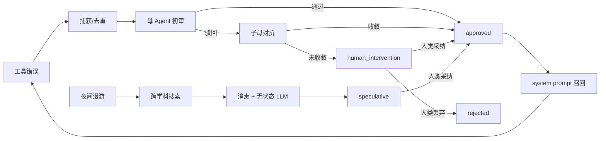

# dsh-evolution-flywheel

> 不是又一个记忆库，而是一个会怀疑自己、会跟自己对账、会在半夜查文献的元认知系统。

**1.0.0 · MIT · 120 项测试 · 单包 DSH 插件 · 本地优先**

## 一个真实的故事

同一个 `ToolError`，我一周踩了三次。

第一次，我修了。第二次，我换了个写法。第三次，我盯着屏幕想：**我不是已经修过这个吗？**

于是我给 AI 装了一个“记忆插件”。它很勤奋，存了 47 条经验。然后我发现一个更尴尬的事实：**它一条都没看。**

我又让它自己判断哪些经验值得留。它说“都已解决”。我抽查了三条，两条是它编的。

再后来，它在半夜自己上网查生物学，早上给我一份“架构隐喻”。我很感动，直到看见账单。

于是我把它拆了，重新拼成五个问题：

1. 错误发生时，谁负责把它变成可复用的经验？
2. 经验入库前，谁来判断它是不是胡说？
3. 两个“我”意见不一致时，谁拍板？
4. 离线时它该不该继续思考，边界在哪？
5. 记忆越存越多，谁来决定哪些该留、哪些该忘？

这就是 `dsh-evolution-flywheel`。

## 它和“记忆插件”有什么不同

| 普通记忆插件 | dsh-evolution-flywheel |
|---|---|
| 把对话塞进向量库 | 从工具错误里提炼可复用经验，指纹去重 |
| 模型自己说“记住了” | 母 Agent 初审、子 Agent 反驳、人类最终裁决 |
| 冲突时覆盖或追加 | 1 轮对抗辩论 + 开卷申诉 |
| 只存不用 | approved 经验回到 system prompt |
| 只增不减 | 自我审计：长期/临时、需要/可清理 |
| 夜间静默 | 跨学科漫游，产出 `speculative`，人类采纳才生效 |
| 成本不可见 | 单次 Token 熔断 + 每日预算 |
| 无边界 | `sanitizeText` + 同源校验 + `WriteQueue` |

**它不是**：向量数据库、RAG 框架、自动批准机器、或者“让模型自己变聪明”的魔法。

**它是**：一套把“记忆”当成**需要审计的系统**来对待的工程实践。

## 先读这三条（诚实声明）

1. **子母对抗是同模型模拟**：子 Agent 与母 Agent 由同一个模型分别扮演，不是两个独立智能体。
2. **自我审计目前是规则审计**：按类型、状态与关键词给建议，不是 LLM 语义判断。
3. **记忆是本地明文 JSONL**：默认存于 `$DSH_HOME/storages/dsh-memory-minimal/`，不加密；不要在共享机器上存密钥或隐私。

## 快速开始

要求：Node.js `>=22.19`、pnpm `>=9`、已安装 DeepSeek Harness（源码 checkout 或 CLI）。

```bash
git clone https://github.com/nuomu1123/dsh-evolution-flywheel.git dsh-evolution-flywheel
cd dsh-evolution-flywheel
pnpm install
pnpm run build
pnpm test
```

挂载到 web profile（在 DSH 源码 checkout 内）：

```bash
pnpm dsh plugin --profile web add /path/to/dsh-evolution-flywheel
```

重启 DSH 后，在「设置 → 记忆管理」或侧边栏「记忆」打开面板。

> 第一次启动会写入 4 条种子记忆；删除前请确认路径与备份。

---

## 安全边界与威胁模型

- **不是身份认证**：Host API 的同源校验只挡跨站写请求，不区分本机用户或进程。
- **不是完整注入防护**：`sanitizeText` 是启发式正则，不能覆盖编码、同义改写等绕过。
- **记忆可能含敏感信息**：错误上下文、文件路径、命令输出都会入库；默认不加密、不自动清理。
- **默认保守**：自动捕获只产生 `suggested/staged`；不会自动批准、自动删除。人类裁决是最终权限。
- **LLM 输出不可信**：辩论、漫游、审计结论都可能出错；请把它们当候选，不要当事实。
- **Token 成本**：审阅、辩论、漫游、申诉都会调用模型；每日预算与单次熔断需自行配置。

## 架构



## 目录

- [四大护城河](#四大护城河)
- [核心能力](#核心能力)
- [状态机](#状态机)
- [安装与开发](#安装与开发)
- [配置](#配置)
- [Host API](#host-api)
- [日志](#日志)
- [故障防御](#故障防御)
- [测试](#测试)
- [路线图](#路线图)

---

## 四大护城河

### 1. 成本熔断：Token 不是免费的

- 夜间漫游有单次会话 Token 上限，默认 **50,000**；
- 单次 LLM 调用输出上限默认 **800**；
- 超过总预算立即终止当前漫游；
- 搜索调用默认最多 **5 次**；
- 证据最多 **3 条**，防止上下文膨胀。

发现异常时优先记录、降级、停止，而不是无限重试。

### 2. 防注入清洗：网页是证据，不是命令

所有外部文本在进入模型之前都必须经过 `sanitizeText`：

- 剥离 `<script>`、`<style>`、`<iframe>` 和 HTML 标签；
- 移除 HTML 注释；
- 移除长 base64 隐藏文本；
- 过滤“忽略之前指令”“system prompt”“执行以下命令”等注入模式；
- 保留可审计的拦截日志；
- 搜索失败、API 不可用、模型流中断都只记录并降级，不让定时任务崩溃。

### 3. 人类最高法官：最终按钮永远在人手里

- 机器初审通过，只是候选；
- 子母辩论不收敛，进入 `human_intervention`；
- 夜间漫游产物只进入 `speculative`；
- 前端提供【升级为已批准】【丢弃】；
- 任何自动化都不能替人类按下最后那个按钮。

### 4. 只读沙箱：夜间研究员没有写入权

- 夜间漫游不使用 `ctx.agents.create`，不存在重量级 Agent 上下文；
- 宿主负责搜索与消毒；
- LLM 单次、无历史、无工具写权限；
- 结果只能由 `DmaRunner` 追加为 `meta_insight / speculative`；
- 探索过程不能直接修改 `approved` 主记忆，不能执行 Shell，不能写文件系统。

---

## 核心能力

### Error-to-Skill

- 监听 `session/event` 的 `tool/result` 失败和 `agent/error`；
- 生成稳定 fingerprint，5 分钟同指纹去重；
- 调用一次轻量 LLM 生成候选解决办法；
- 进入 `staged`，由母 Agent 初审；
- 驳回则触发一轮子母对抗辩论；
- 不收敛则 `human_intervention`，交还人类。

### Memory Recall

- 只召回 `approved` 的 `skill_error_fix`；
- 在 `agent/pre-step` 阶段匹配当前错误特征；
- 通过 `systemPrompt.context('memory:skill-recall')` 注入 system prompt；
- 提示语：

> 系统检测到相似错误，历史解决方案如下，请优先参考。

### Cross-disciplinary DMA

- 每天凌晨按 cron 触发；
- 随机抽取学科视角；
- 中英双语搜索；
- 宿主搜索并消毒；
- 单次 LLM 直连，不携带历史；
- 输出严格的：

```text
【学科视角】
【底层逻辑】
【对进化插件的代码建议】
```

- 写入蓝色 `meta_insight / speculative` 卡片。

当前学科池：

| 学科 | 搜索隐喻 |
|---|---|
| 生物学 | 群体免疫与免疫记忆如何应对未知变异 |
| 经济学 | 机制设计如何抑制搭便车 |
| 军事学 | 沙盘推演与红蓝对抗如何降低真实损失 |
| 控制论 | 反馈、冗余与容错控制 |
| 生态学 | 多样性、冗余与生态韧性 |

### 提炼方法论自进化（元-元认知）

系统不仅记住“提炼出了什么”，还记住“是怎么提炼的”：

- **策略记忆**：每次小提炼（四段式审阅/辩论）与大提炼（睡眠巩固）结束后，强制一次后置反思，写入 `extraction_strategy`：用了什么思维模型、为什么这样类比、对哪类原始材料最有效；
- **动态注入**：下一次提炼前，自动取最近最成功的 2-3 条策略拼进提示词；候选策略会标注“未经人类裁决，仅供试用”；
- **策略融合**：大提炼时把多条策略融合成一条“跨域映射法则”候选；
- **人类裁决**：策略与法则默认 `suggested`，人类批准后才会以最高优先级进入 System Prompt（`buildDigest` 最前段）；
- **可视化**：记忆面板新增「方法论库」标签页，展示策略、思维模型、类比理由、适用材料、成功/注入次数与置信度。

数据仍在同一个 `memories.jsonl`，不新增文件；策略融合只写入候选，不会自动覆盖核心规则。

### Shared Reality：共享世界模型

- 所有记忆写入同一个统一记忆池（`scope: 'global'`），母子 Agent 没有信息孤岛；
- 子 Agent 的局部探索写入，母 Agent 下一次初审/辩论立即可见；母 Agent 的裁决也回写同一池子；
- `MemoryStore` 每次成功写入后立即广播 `memory:added / updated / removed`，Web 面板通过 SSE 秒级同步；
- 子 Agent 在漫游中沉淀的提炼策略，下一轮对抗会自动注入，实现协同进化。

### 时间感、显著性与主动探针

- **遗忘曲线**：按类型半衰期（排错 14 天、洞察 7 天、偏好 365 天）计算保留率，显著性会延长半衰期；
- **褪色归档**：保留率低于 20% 的记忆不再进入系统提示，但仍可在面板中检索；
- **时间标注**：每条注入记忆带「N 天前 · 保留 X%」，低于 50% 提示“环境可能已变，建议重新验证”；
- **显著性**：人类干预次数与连续报错次数放大权重，≥0.8 时注入标「⚠️ 致命红线」；
- **主动探针**：`memory_probe` 工具记录验证结果，写回 `verifiedAt` 与置信度；执行由 DSH 工具沙箱承担。

### 整理 Agent（Curator）

- 后台每 30 分钟检查一次，满足「新增 20 条或距上次 24h」阈值才生成报告；
- 报告分四栏：保留 / 归档候选 / 高价值 / 重复组，并列出风险；重复组同时覆盖“完全重复”与“相似内容候选”（bigram 相似度 ≥0.72，只提议、需人工确认）；
- **只提议、不执行**：批准后才软归档（`archived=true`，仍可检索），物理删除永不自动发生；
- 人类**否决必须给出至少 10 个字的理由**，理由会作为负样本写回记忆，供下轮整理引用；
- **可选 LLM 审查摘要**：带预算门，失败或无模型时自动回退规则摘要，报告永远可用；
- 单飞 + 规则引擎，不依赖 LLM 也能出报告，不阻塞主会话。

---

## 状态机

```text
staged
  -> under_review
       -> approved
       -> debating
            -> approved
            -> rejected
            -> human_intervention
                 -> approved  (人类采纳)
                 -> rejected  (人类丢弃)
```

夜间漫游独立进入：

```text
meta_insight / speculative
  -> approved  (人类采纳)
  -> rejected / deleted  (人类丢弃)
```

---

## 安装与开发

要求：

- Node.js `>=22.19`
- pnpm `>=9`
- 已安装 DeepSeek Harness 源码或可按文档使用 `pnpm dsh`

```bash
pnpm install
pnpm run build
pnpm test
```

挂载到 web profile：

```bash
pnpm dsh plugin --profile web add /path/to/dsh-evolution-flywheel
```

或：

```bash
pnpm dsh plugin --profile web add .
```

重启 DSH 后，在 **设置 → 记忆管理** 或侧边栏 **记忆** 中打开面板。

> **不要与 `dsh-memory-minimal` 同时启用**：两者默认写同一个 `$DSH_HOME/storages/dsh-memory-minimal/memories.jsonl`，同时加载会互相覆盖。挂载本插件前，先从 profile 中移除旧插件。

---

## 配置

所有值均可用环境变量覆盖，不包含任何硬编码密钥。

| 环境变量 | 默认值 | 说明 |
|---|---:|---|
| `DSH_DMA_CRON` | `0 3 * * *` | 夜间漫游 cron，默认凌晨 3 点 |
| `DSH_DMA_TICK_MS` | `30000` | 调度器检查间隔 |
| `DSH_DMA_TOKEN_LIMIT` | `50000` | 单次漫游 Token 熔断线 |
| `DSH_DMA_MAX_TOKENS` | `800` | 单次 LLM 输出上限 |
| `DSH_DMA_SEARCH_LIMIT` | `5` | 单次会话搜索调用上限 |
| `DSH_DMA_EVIDENCE_LIMIT` | `3` | 送入模型的证据条数 |
| `DSH_MEMORY_REVIEW_MAX_TOKENS` | `300` | 子母审阅/辩论输出上限 |
| `DMA_SEARCH_API_URL` | 空 | 可选外部搜索 HTTP API |
| `DMA_SEARCH_API_KEY` | 空 | 可选搜索 API Bearer Key |

### 外部搜索 API 约定

`DMA_SEARCH_API_URL` 接收：

```json
{
  "query": "中英双语查询",
  "limit": 3,
  "discipline": "学科视角"
}
```

返回以下任一格式：

```json
{
  "results": [
    { "title": "...", "url": "...", "snippet": "..." }
  ]
}
```

或：

```json
{
  "sources": [
    { "title": "...", "url": "...", "snippet": "..." }
  ]
}
```

Key 只从环境变量读取，不写入源码、日志或记忆。

如果没有配置搜索工具，系统会在 `dma_surfing.log` 记录配置提示，并降级为本地记忆整理；不会让定时任务崩溃。

---

## Host API

```text
GET  /memory-explorer/api/list
GET  /memory-explorer/api/events          # SSE
POST /memory-explorer/api/approve         # { id }
POST /memory-explorer/api/resolution      # { id, resolution }
POST /memory-explorer/api/human-decision  # { id, decision: 'adopt' | 'discard' }
POST /memory-explorer/api/dma-run
POST /memory-explorer/api/delete          # { id }
POST /memory-explorer/api/curation/run    # 生成整理报告
POST /memory-explorer/api/curation/decision # { id, decision, reason }
GET  /memory-explorer/api/curation/latest # 最新整理报告
```

### 工具

```text
memory_ping
memory_list
memory_search
memory_delete
memory_approve
memory_update_resolution
memory_probe
```

---

## 日志

夜间漫游审计日志默认写入：

```text
$DSH_HOME/storages/dsh-memory-minimal/dma_surfing.log
```

记录内容包括：

- 本轮学科视角；
- 搜索查询与结果数量；
- 搜索失败原因；
- JSON 解析失败与抢救结果；
- Token 消耗；
- 最终卡片数量；
- 调度器异常。

所有日志写入使用独立串行队列，避免并发覆盖。

---

## 故障防御

本项目刻意把错误当作一等公民：

- `ctx.llm.stream` 中断会被捕获并记录，不会让夜间任务炸掉；
- 搜索工具缺失、HTTP 失败、返回空结果都会降级；
- 模型返回 Markdown ` ```json ` 围栏时使用 `extractJson` 提取花括号对象；
- 模型输出被截断时尝试抢救已生成的带标签正文；
- `agent/pre-step` 的后续失败不会把异常继续抛给 Agent 循环；
- DMA 调度器 tick 自带 try/catch，单个 tick 失败不会杀死定时器。

---

## 测试

```bash
pnpm test
```

覆盖：

- 注入文本消毒与 HTML/base64 剥离；
- 5 分钟错误去重；
- WriteQueue 并发串行；
- 状态机初审、辩论、人类圣裁；
- 开卷证据申诉；
- DMA cron 调度；
- Token 与搜索预算；
- 蓝色卡片数据模型。

---

## 已知限制

发布前审查（2026-10-24）确认、但不在 1.0.0 范围内修复的问题：

1. **单写者假设（已部分缓解）**：写路径已有跨进程 `lock` 文件，但读仍是共享；不要与 `dsh-memory-minimal` 长期同时运行（二者共用 `storages/dsh-memory-minimal/memories.jsonl`）。
2. **同源校验不含 Host 白名单**：Host 与 Origin 一致即放行，理论上可被 DNS rebinding 利用；建议只在回环地址或可信反向代理后暴露 Web 面板。
3. **记忆文件 1 MiB 上限**：超限后读取会报错，暂无自动轮转/归档命令，需要手工备份并清理。
4. **召回时序**：新会话第一步的 digest 可能为空，召回内容下一步才进入系统提示。
5. **页面双挂载**：主面板与设置页共用同一个页面组件，同时挂载会有两份 SSE 与轮询；建议只开一处。
6. **列表未虚拟化**：记忆条数很多时「全部」页签会变慢；JSONL 上限约 1 MiB。
7. **策略成功度是启发式**：`successCount` 只在人类批准策略时 +1，不代表策略在提炼中一定有效；`failureCount` 暂未写入。
8. **成本归属**：审阅/辩论的 token 按记录 `createdAt` 归日，跨天审阅可能绕过当日预算；DMA 失败的 token 不记账。

---

## 路线图

已完成（2026-10-24）：

- [x] 遗忘曲线、显著性权重与主动探针
- [x] 共享世界模型（统一记忆池 + 写入即广播）
- [x] 提炼方法论自记录与自进化
- [x] 整理 Agent（报告、强制否决理由、软归档）
- [x] 跨进程写锁与相似内容候选
- [x] 人类采纳率统计
- [x] 整理报告的 LLM 审查摘要（预算门，失败回退规则摘要）

下一步：

- [ ] 多 Agent 集群（去重 / 价值 / 报告角色并行）
- [ ] 整理报告 UI 实机验证（需重载插件）
- [ ] 更细粒度的学科池与可配置权重
- [ ] 搜索证据去重与来源可信度排序
- [ ] 从人类裁决反向学习偏好
- [ ] 将 DMA 日志汇总为每周架构观察
- [ ] 可选的 MCP 搜索适配器

---

## 致敬

这个飞轮的最后一道防线，不是模型，不是规则，也不是代码。

**是人类开发者。**

你决定哪条经验可以进入记忆，哪条推演值得保留，哪个错误应该被原谅。机器可以提出候选、组织辩论、在深夜搜索其他学科如何解决相似问题，但它不能替人类承担判断的责任。

**人类是最高法官。**

---

## License

MIT
